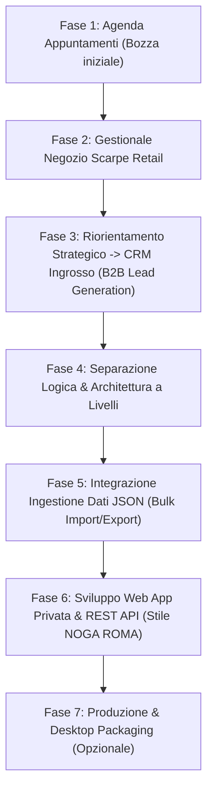
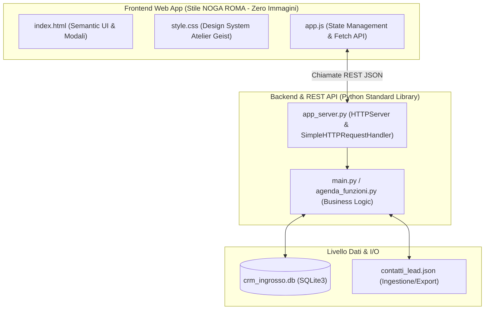

# Documentazione di Progetto: CRM Acquisizione Clienti all'Ingrosso & Web App NOGA ROMA

## 1. Visione Generale e Obiettivo

Il progetto nasce dall'evoluzione di un esercizio accademico su SQLite (inizialmente una semplice agenda appuntamenti) per diventare un **CRM commerciale B2B per la Lead Generation e l'Acquisizione di Acquirenti all'Ingrosso per Calzature**.

Il software supporta gli operatori commerciali nella gestione delle campagne telefoniche (outreach):
- Inserimento e catalogazione di punti vendita, catene retail e boutique di calzature.
- Gestione focalizzata della coda delle telefonate da effettuare (`chiamato = 'No'` o `esito = 'Da richiamare'`).
- Tracciamento dello stato della chiamata (`Sì` / `No`) e dell'esito commerciale (`Interessato (Ordine preso)`, `Non interessato (Rifiutato)`, `Da richiamare`, `In attesa`).
- Storico cronologico cumulativo delle conversazioni e note commerciali con separatore temporale `|`.
- Importazione ed esportazione massiva da file **JSON** esterni con controllo automatico dei duplicati sul recapito telefonico.
- Cruscotto con calcolo automatico dei KPI di rendimento e tasso di conversione (rapporto ordini/telefonate).
- **Interfaccia Web App Privata** integrata con estetica luxury minimale ispirata al sito ufficiale [NOGA ROMA](https://nogashoes.com/) (0 immagini, tipografia Geist, palette calda neutra).

---

## 2. Planning ed Evoluzione delle Fasi di Sviluppo



### Tabella di Avanzamento e Decisioni Progettuali

| Fase | Requisito / Problema | Soluzione Adottata | Stato |
| :--- | :--- | :--- | :--- |
| **Fase 1** | Struttura iniziale limitata ad appuntamenti personali (`data`, `titolo`, `luogo`). | Riconfigurazione del modello dati verso entità commerciali. | Completato |
| **Fase 2** | Necessità di tracciare cliente, numero e stato ordine scarpe. | Creazione schema con cliente, recapito telefonico, chiamata (Sì/No) e stato ordine. | Completato |
| **Fase 3** | Cambio focus: non vendita al dettaglio, ma **acquisizione buyer all'ingrosso**. | Modello B2B: azienda, referente, telefono, città, storico note, coda da chiamare e metriche. | Completato |
| **Fase 4** | Codice manutenibile e scalabile per future interfacce grafiche. | **Clean Architecture**: funzioni database che restituiscono dati puri, disaccoppiate da `print()` e `input()`. | Completato |
| **Fase 5** | Caricamento rapido di liste di contatti fornite da elenchi esterni. | Ingestione via file `.json` con validazione campi e filtro anti-duplicati su numero telefonico. | Completato |
| **Fase 6** | Interfaccia grafica di lusso per uso interno, fedele a [nogashoes.com](https://nogashoes.com/). | **Web App Privata**: 0 immagini, font Geist, palette sand/noir, REST API nativa senza dipendenze `pip`. | Completato |

---

## 3. Tecnologie Utilizzate e Scelte Architetturali

Tutto il backend dell'applicazione è sviluppato interamente con strumenti della **Python Standard Library**, garantendo:
- **Portabilità assoluta**: nessuna dipendenza esterna da installare (`pip install` non necessario).
- **Leggerezza e reattività**: avvio istantaneo sia su Windows che su Linux/macOS.
- **Transizionalità nativa**: conformità ACID grazie al motore SQLite integrato.
- **Frontend Moderno Vanilla**: HTML5, Vanilla CSS e Vanilla JavaScript nativo (nessun framework o build step pesante).



1. **`sqlite3`**: Motore relazionale locale con `conn.row_factory = sqlite3.Row`.
2. **`http.server` & `urllib.parse`**: Server HTTP e dispatcher di rotte REST JSON asincrone.
3. **`json`**: Serializzazione, validazione e parsing di elenchi anagrafici.
4. **`datetime`**: Tracciamento ISO compatto (`%Y-%m-%d %H:%M`) per audit delle chiamate.
5. **`Geist & Geist Mono`**: Famiglia di caratteri tipografici ufficiali di NOGA ROMA per massima leggibilità e identità editoriale.

---

## 4. Architettura del Database

### Schema della Tabella `contatti_ingrosso`

```sql
CREATE TABLE IF NOT EXISTS contatti_ingrosso (
    id INTEGER PRIMARY KEY AUTOINCREMENT,
    azienda TEXT NOT NULL,
    telefono TEXT NOT NULL,
    citta TEXT DEFAULT '',
    note TEXT DEFAULT '',
    chiamato TEXT DEFAULT 'No',
    esito TEXT DEFAULT 'In attesa',
    data_aggiornamento TEXT
);
```

### Dizionario Dati

| Campo | Tipo | Descrizione | Valori Ammessi / Note |
| :--- | :--- | :--- | :--- |
| `id` | `INTEGER` | Identificativo primario univoco progressivo | Auto-incrementale |
| `azienda` | `TEXT` | Ragione sociale del negozio / nome referente | Obbligatorio (`NOT NULL`) |
| `telefono` | `TEXT` | Recapito telefonico da comporre | Obbligatorio, indicizzato per check duplicati |
| `citta` | `TEXT` | Località geografica del punto vendita | Opzionale (default stringa vuota) |
| `note` | `TEXT` | Note commerciali e storico telefonate | Concatenazione progressiva con separatore `\|` |
| `chiamato` | `TEXT` | Flag indicante se il contatto è stato raggiunto | `'Sì'` / `'No'` (default `'No'`) |
| `esito` | `TEXT` | Risultato commerciale della chiamata | `'In attesa'`, `'Interessato (Ordine preso)'`, `'Non interessato (Rifiutato)'`, `'Da richiamare'` |
| `data_aggiornamento` | `TEXT` | Data e ora dell'ultima telefonata registrata | Formato standard ISO compatto (`%Y-%m-%d %H:%M`) |

---

## 5. Dettaglio dei 4 Livelli del Sistema

### Livello 1: Business Logic & Funzioni Database ([main.py](file:///c:/Progetti%20Lavoro/Noga_Gestionale/main.py))
- [connetti()](file:///c:/Progetti%20Lavoro/Noga_Gestionale/main.py#L14): Connessione riutilizzabile con row_factory SQLite.
- [crea_tabella()](file:///c:/Progetti%20Lavoro/Noga_Gestionale/main.py#L21): DDL protetto da gestione eccezioni `sqlite3.Error`.
- [telefono_esiste(telefono)](file:///c:/Progetti%20Lavoro/Noga_Gestionale/main.py#L57): Controllo univocità per bloccare inserimenti doppi.
- [aggiungi_contatto(...)](file:///c:/Progetti%20Lavoro/Noga_Gestionale/main.py#L71): Inserimento parametrizzato con segnaposto `?` anti-SQL-injection.
- [ottieni_tutti_contatti()](file:///c:/Progetti%20Lavoro/Noga_Gestionale/main.py#L90): Ritorna l'anagrafica globale ordinata per ID.
- [ottieni_contatti_da_chiamare()](file:///c:/Progetti%20Lavoro/Noga_Gestionale/main.py#L108): Filtra la coda operativa (`chiamato = 'No' OR esito = 'Da richiamare'`).
- [cerca_contatti(termine)](file:///c:/Progetti%20Lavoro/Noga_Gestionale/main.py#L127): Ricerca multicampo con `LIKE %termine%`.
- [registra_esito_chiamata(...)](file:///c:/Progetti%20Lavoro/Noga_Gestionale/main.py#L161): Aggiorna stato ed esito, accodando le nuove osservazioni con operatore SQLite `||`.
- [ottieni_statistiche()](file:///c:/Progetti%20Lavoro/Noga_Gestionale/main.py#L283): Calcolo aggregato con `COUNT(*)` per KPI del cruscotto.
- [elimina_contatto(id)](file:///c:/Progetti%20Lavoro/Noga_Gestionale/main.py#L316): Cancellazione fisica sicura di un record.

### Livello 2: Gestione File Esterni (JSON Ingestione ed Esportazione)
- [importa_contatti_da_json(percorso_file)](file:///c:/Progetti%20Lavoro/Noga_Gestionale/main.py#L194):
  1. Validazione esistenza file tramite `os.path.exists()`.
  2. Parsing sicuro con `json.load()`.
  3. Validazione obbligatorietà campi minimi (`azienda` e `telefono`).
  4. Scarto duplicati se il numero telefonico è già censito.
  5. Inserimento in blocco e report diagnostico.
- [esporta_contatti_in_json(percorso_file)](file:///c:/Progetti%20Lavoro/Noga_Gestionale/main.py#L255): Serializzazione dell'intero catalogo per backup e scambio dati.

### Livello 3: Server HTTP & Specifica REST API ([app_server.py](file:///c:/Progetti%20Lavoro/Noga_Gestionale/app_server.py))
Espone una suite di endpoint JSON e serve i file statici del frontend:

| Metodo | Endpoint | Parametri / Payload | Descrizione |
| :--- | :--- | :--- | :--- |
| `GET` | `/api/contatti` | `?filtro=da_chiamare`, `?q=testo` | Restituisce la lista filtrata o completa dei contatti |
| `POST` | `/api/contatti` | `{ azienda, telefono, citta, note }` | Registra un nuovo buyer (409 se telefono duplicato) |
| `POST` | `/api/contatti/{id}/chiamata` | `{ chiamato, esito, note }` | Registra l'esito della telefonata e accoda le nuove note |
| `DELETE`| `/api/contatti/{id}` | - | Elimina il contatto dal database |
| `GET` | `/api/statistiche` | - | Restituisce KPI, tasso conversione % e completamento coda |
| `POST` | `/api/importa-json` | `{ contatti: [...] }` o `{ percorso_file }` | Ingestione massiva con conteggio duplicati scartati |
| `GET` | `/api/esporta-json` | - | Esportazione backup JSON di tutti i record |
| `POST` | `/api/ripristina-demo`| - | Ripristino veloce dei lead dimostrativi di test |

### Livello 4: Frontend Web App Privata ([index.html](file:///c:/Progetti%20Lavoro/Noga_Gestionale/index.html), [style.css](file:///c:/Progetti%20Lavoro/Noga_Gestionale/style.css), [app.js](file:///c:/Progetti%20Lavoro/Noga_Gestionale/app.js))
- **Top Announcement Bar**: barra superiore con stato di connessione SQLite in tempo reale.
- **Cruscotto KPI Ribbon**: 5 contatori interattivi (Portafoglio, Da Chiamare, Raggiunti, Ordini Presi, Tasso di Conversione %).
- **Tab Coda Chiamate**: tabella focalizzata con azione rapida per operatore e link `tel:`.
- **Tab Anagrafica Master**: catalogo completo con ricerca istantanea, badge di stato e filtri per esito.
- **Tab Cruscotto & Report**: funnel grafico delle telefonate e ripartizione commerciale.
- **Slide-over Drawer**: scheda laterale con visualizzazione cronologica delle annotazioni.
- **Modali Dedicati**: inserimento nuovo lead, registrazione esito telefonata e importazione JSON con drag & drop o codice grezzo.

---

## 6. Design System & Identità Visiva NOGA ROMA

In linea con le indicazioni del cliente e l'estetica di [nogashoes.com](https://nogashoes.com/), l'interfaccia adotta un'identità visiva essenziale di alta gamma:

- **Zero Immagini**: Nessuna fotografia né icona raster; l'impatto visivo si fonda sulla tipografia e sulle proporzioni architettoniche.
- **Palette Cromatica**:
  - `var(--bg-sand)`: `#F8F7F5` (lo sfondo iconico NOGA ROMA).
  - `var(--bg-white)`: `#FFFFFF` (superfici tabellari e card).
  - `var(--text-noir)`: `#0D0D0D` (nero profondo con `border-radius: 0px`).
  - `var(--border-light)`: `#E5E3DE` (linee sottili hairline).
- **Tipografia**:
  - Famiglia principale: `Geist, sans-serif` (letter-spacing calibrato, maiuscolo per le intestazioni).
  - Famiglia dati: `Geist Mono` per numeri di telefono, ID e date per perfetto allineamento tabellare.
- **Palette Badges Esiti**:
  - *Interessato (Ordine preso)*: Sfondo `#EDF5EE`, testo `#1B4D27`, bordo `#BDD8C2`.
  - *Da richiamare*: Sfondo `#FDF5E8`, testo `#8A5208`, bordo `#EED7AE`.
  - *Non interessato (Rifiutato)*: Sfondo `#FDF1F1`, testo `#852222`, bordo `#EBBBBB`.
  - *In attesa*: Sfondo `#EFEFEA`, testo `#484642`, bordo `#D5D3CB`.

---

## 7. Guida all'Uso e Avvio del Sistema

### Avvio Web App
Da terminale, posizionandosi nella cartella di progetto:
```bash
python app_server.py
```
Accedere via browser all'indirizzo:
`http://localhost:8080/index.html`

### Avvio Terminale (CLI Legacy)
Per gli operatori che preferiscono l'ambiente a riga di comando:
```bash
python main.py
```

### Esempio di File JSON per Importazione Massiva
Il file [contatti_lead.json](file:///c:/Progetti%20Lavoro/Noga_Gestionale/contatti_lead.json) fornisce la struttura standard per il caricamento dati:

```json
[
  {
    "azienda": "Calzature Elegance Srl",
    "telefono": "0298765431",
    "citta": "Milano",
    "note": "Catena con 3 negozi in centro, interessati a forniture di scarpe eleganti in pelle"
  },
  {
    "azienda": "Boutique del Piede di Marco Neri",
    "telefono": "0655443322",
    "citta": "Roma",
    "note": "Negozio storico, cercano stock di scarpe sportive e sneakers per primavera"
  }
]
```

---

## 8. Considerazioni di Sicurezza e Scalabilità Futura

1. **Integrità dei Dati**: La gestione tramite query SQLite parametrizzate protegge da vulnerabilità di SQL Injection sia su CLI che tramite API REST.
2. **Prevenzione Conflitti**: Il filtro duplicati garantisce che lo stesso buyer non riceva chiamate sovrapposte da più operatori.
3. **Distribuzione su Rete Locale**: Il server può essere collegato all'indirizzo IP locale della sede (es. `0.0.0.0:8080`) per consentire l'accesso simultaneo da più postazioni aziendali.
